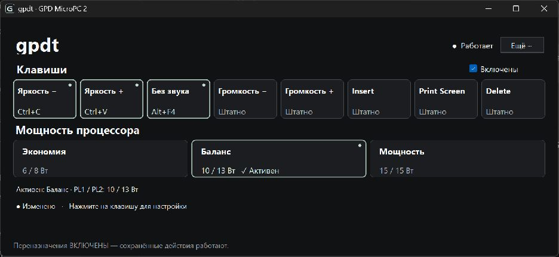

# gpdt

Кнопки и мощность **GPD MicroPC 2 G1688-08** под Windows 11 x64.



- Восемь клавиш в один ряд: нажмите на любую, чтобы изменить её действие. Переназначения отмечены рамкой и точкой.
- Копирование и вставка на кнопках яркости без изменения яркости экрана.
- Три режима мощности: «Экономия», «Баланс» и «Мощность». Активный режим определяется по фактическим лимитам процессора.
- Работа в трее, автозапуск и отмена последнего сброса назначений.

## Скачать и запустить

Установщик `gpdt-v1.0.4-setup-x64.exe` включает программу, PawnIO 2.2.0, модуль мощности и фильтр кнопок для чистой Windows 11 x64 на GPD MicroPC 2 G1688-08. Интернет при установке не требуется. Подтвердите запрос администратора, оставьте галочку автозапуска и на отдельном шаге разрешите установку драйверов и сертификата фильтра. Если Windows потребует перезагрузку, мастер предложит её в конце. Повторное подтверждение прав при входе не требуется.

Фильтр подписан локальным сертификатом со сроком действия до 12 ноября 2036 года; для более поздней установки нужна обновлённая подписанная сборка. Мастер проверяет устройство, подписи и контрольную сумму PawnIO до установки. Подробности и ручное восстановление — [в инструкции](docs/RESTORE.md). Удаление gpdt сохраняет драйверы, доверенный сертификат и личные настройки.

При обновлении выберите прежнюю папку программы — личная папка `data` сохраняется. При переходе с переносимой версии в другую папку перенесите туда свою `data` до первого запуска. Удаление программы сохраняет личные настройки и убирает задачу автозапуска, только если она относится к удаляемой копии.

Переносимая версия:

1. Скачайте архив `gpdt-v1.0.4-win-x64.zip` из Releases.
2. Распакуйте в постоянную папку, например `D:\gpdt`. Не запускайте из архива.
3. Запустите `gpdt.exe` и подтвердите запрос администратора.
4. Если Windows переустановлена или это другой компьютер, сначала выполните [инструкцию восстановления](docs/RESTORE.md).

Для обновления замените программу и сопутствующие файлы, **сохранив свою папку `data`**. Архив релиза не содержит `data` и не перезаписывает ваши назначения.

## Клавиши

Начальные назначения:

| Кнопка | Действие |
|---|---|
| Яркость − | Ctrl+C |
| Яркость + | Ctrl+V |
| Без звука | Alt+F4 |
| Остальные | Штатное действие |

Яркость подавляется UMDF-фильтром. Обеим кнопкам яркости нужно назначение: сочетание или «Отключить кнопку». Если одну вернуть в «Без изменения», обе снова регулируют яркость. При выходе из приложения подавление снимается; при потере связи действует тайм-аут 2 секунды.

Неопределённую кнопку сначала нужно физически нажать в режиме «Определить кнопку». Сброс выбранной кнопки не затрагивает остальные. Полный сброс и отмена последнего сброса доступны в меню «Ещё» и требуют подтверждения.

Настройки хранятся в `data/bindings.xml`. Снимок перед сбросом — `data/bindings-before-reset.xml`; история сохранений — `data/binding-history`.

## Мощность

| Режим | PL1 / PL2 |
|---|---|
| Экономия | 6 / 8 Вт |
| Баланс | 10 / 13 Вт |
| Мощность | 15 / 15 Вт |

Нажатие на режим **сразу применяет лимиты**. Активный режим определяется чтением процессора при запуске и каждые 5 секунд. Если значения другие, отображаются фактические лимиты без выбранного пресета.

Успешно применённый режим сохраняется в `data/power-mode.xml` и автоматически восстанавливается при следующем запуске, включая вход в Windows после перезагрузки. Это относится и к трём режимам на главной, и к ручным лимитам после нажатия «Применить лимиты». Если PawnIO ещё не готов, приложение повторяет попытку каждые 5 секунд. После успешного применения постоянной перезаписи лимитов нет. «Вернуть исходные» восстанавливает значения, прочитанные при подключении к процессору, и удаляет сохранённый режим. Без сохранённого режима приложение только читает лимиты; после обновления выберите нужный режим один раз.

PL1/PL2 — лимиты процессора, не потребление всего компьютера. Для доступа нужен обычный подписанный PawnIO и `drivers/IntelMSR.bin`. Блокировки BIOS не снимаются. Повреждённые или недопустимые сохранённые значения не применяются; причина показана в настройках мощности.

## Трей и автозапуск

Если фильтр яркости ещё не готов при входе в Windows или связь с ним потеряна, приложение повторяет подключение каждые 3 секунды. Если каналы кнопок не готовы за 10 секунд, подключение также повторяется. При выключенных переназначениях повторные попытки прекращаются.

Крестик при включённых переназначениях сворачивает программу в трей. Двойной щелчок по значку открывает окно. Полный выход: меню значка → «Выход». Аварийное отключение: Ctrl+Alt+Pause.

Автозапуск включается и выключается в **Ещё → Настройки запуска**. Права администратора обязательны для работы кнопок и включены автоматически. Переключатель показывает фактическую настройку задачи для этой копии программы.

Также автозапуск для текущего пользователя можно настроить из PowerShell от администратора:

```powershell
powershell -NoProfile -ExecutionPolicy Bypass -File .\scripts\autostart.ps1
```

Отключение: тот же скрипт с `-Disable`. После переноса папки настройте задачу заново.

Автозапуск выполняется с наивысшими правами через Планировщик заданий → Библиотека планировщика заданий → `gpdt - user logon`. В списке автозагрузки Диспетчера задач эта задача не отображается.

## Сборка

Windows, PowerShell и компилятор .NET Framework 4.x. Отдельный .NET SDK для приложения не нужен.

```powershell
.\build.ps1
.\gpdt.exe --self-test
.\scripts\package.ps1
```

Закройте запущенный gpdt перед сборкой поверх его exe, либо укажите `-OutputPath`.

Сборка установщика: `scripts/build-installer.ps1` (нужен Inno Setup 6; путь к `ISCC.exe` можно передать через `-Compiler`).
Самопроверка проверяет ABI, HID-переходы и кодирование мощности без изменения аппаратных лимитов. Результат: `data/self-test.txt`.

Исходники приложения — `src`; значок и его генератор — `assets`, `scripts/build-icon.ps1`; текущий UMDF-фильтр — `umdf`. Старого KMDF-фильтра и включения тестового режима в проекте нет.

## Проверено и ограничения

На авторском GPD MicroPC 2 работа копирования/вставки без изменения яркости подтверждена физически после перезагрузки в обычном режиме Windows. Установка на чистую Windows с другими политиками доверия отдельно не проверена. UMDF-пакет подписан локальным сертификатом, а не Microsoft; восстановление описано отдельно.

Диагностика клавиш включается вручную на 60 секунд. Не вводите пароли во время записи. Логи остаются локально. Настройки и диагностические логи не входят в Git.

[Восстановление](docs/RESTORE.md) · [Сторонние компоненты](docs/THIRD-PARTY.md) · [Изменения](CHANGELOG.md)
